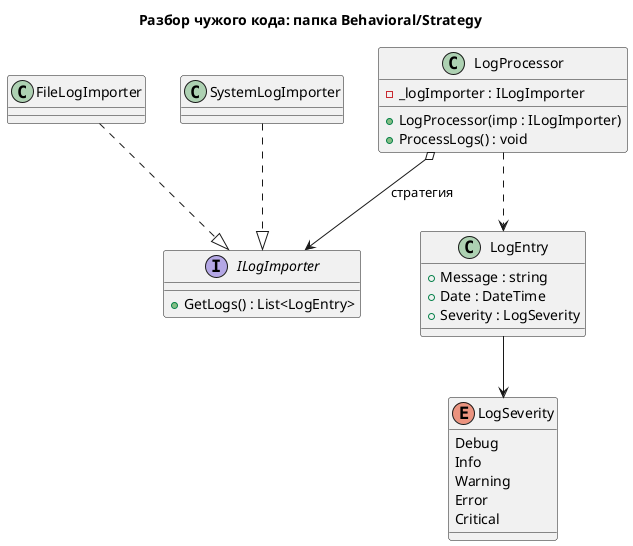
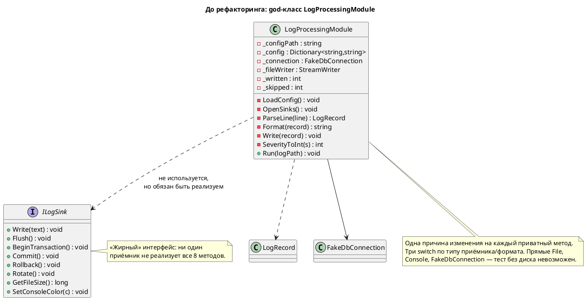
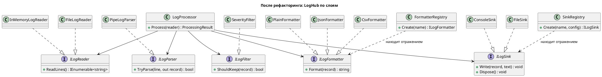

# Лабораторная работа 1 (ЛР4). Git, среда и SOLID

**Студент:** Харченко Иван, БИСО-02-24
**Вариант:** 10 — Windows Event Log (JSON-выгрузка); приёмники: консоль, файл; особое требование: фильтр по источнику события
**Репозиторий:** https://github.com/Kouwkik/Lecture_Examples (форк учебного репозитория)
**Pull Request:** _ссылка после открытия PR `feature/лр-1 → develop`_

> Примечание по варианту: формат Windows Event Log и фильтр по источнику
> реализуются начиная с ЛР3 (импортёры). В этой работе разбирается и
> рефакторится общий god-класс из учебного репозитория (формат
> «дата\|уровень\|сообщение»), а интерфейсы выделены так, чтобы формат
> варианта позже встал на место Стратегией без правки конвейера.

---

## Задача

Завести рабочий процесс (форк, ветки, защита `main`, зелёный CI) и собрать
каркас LogHub. Затем прочитать чужой код из учебного репозитория и
разделить god-класс `LogProcessingModule` на слои так, чтобы добавление
нового приёмника не требовало правки существующих файлов, а разбор строки
и маршрутизацию можно было протестировать без файловой системы.

---

## Диаграмма классов

### 1. Разбор чужого кода — папка `Behavioral/Strategy`

Прочитана папка паттерна Strategy из учебного репозитория
([Implementation/Behavioral/Strategy](https://github.com/clgray/Lecture_Examples/tree/master/DesignPatterns/Implementation/Behavioral/Strategy)).
Контекст `LogProcessor` хранит ссылку на интерфейс-стратегию `ILogImporter`
и не знает, какой именно источник ему подставили; две конкретные стратегии
(`FileLogImporter`, `SystemLogImporter`) взаимозаменяемы. Выбор источника —
решение времени выполнения, а не `switch` внутри процессора. Это ровно та
развязка, к которой приводится LogHub ниже, и к которой он вернётся в ЛР3,
когда источник станет полноценной Стратегией.



### 2. До рефакторинга — god-класс `LogProcessingModule`



### 3. После рефакторинга — LogHub по слоям



---

## Найденные нарушения SOLID

Строки указаны по исходному
[`LogProcessingModule.cs`](https://github.com/clgray/Lecture_Examples/blob/master/DesignPatterns/Implementation/_AntiPatterns/GodObject/LogProcessingModule.cs).
Комментарии в файле подсказывают часть мест; остальные (LSP, DIP на `Console`,
утечка ресурса) ничем не помечены.

| Принцип | Где (строки) | Почему это нарушение |
|---|---|---|
| **SRP** | весь класс; `LoadConfig` 52, `OpenSinks` 83, `ParseLine` 112, `Format` 143, `Write` 168, фильтр 228, `SeverityToInt` 246 | У класса не одна, а семь причин измениться: формат конфига, способ хранилища, формат логов, формат вывода, набор приёмников, правило фильтра, шкала уровней. На «кто придёт менять» получается семь разных людей. |
| **OCP** | `OpenSinks` 87, `Write` 174, `Format` 146 | Добавление приёмника требует синхронной правки двух `switch` (открытие + запись); новый формат — правки третьего. Класс закрыт для расширения и открыт для правок. |
| **LSP / ISP** | `ILogSink` 264–274 | Интерфейс из восьми методов (`Write`, `Flush`, `BeginTransaction`, `Commit`, `Rollback`, `Rotate`, `GetFileSize`, `SetConsoleColor`). Консоль не умеет транзакций, база — ротации файлов; любая реализация вынуждена бросать `NotSupported` в половине методов и потому неподставима (LSP), а причина — раздутый интерфейс (ISP). |
| **DIP** | поля 40, 43; `File` 55/64/215; `Console` 191–196; путь 36 | Высокоуровневый `Run` зависит от конкретных `FakeDbConnection`, `StreamWriter`, статических `File` и `Console` и зашитого пути к конфигу. Подменить их в тесте нельзя — тест обязан трогать настоящий диск. |
| _смежное: надёжность_ | `ParseLine` 122 (молчит и возвращает `null`); ручной `Dispose` 239 без `using`/`finally` | Из сигнатуры не следует, что метод может вернуть `null`; исключение в середине цикла оставит файл открытым. |

---

## Применённые паттерны

| Паттерн | Где применён | Почему именно он |
|---|---|---|
| **Реестр по атрибутам** (Registry + рефлексия) | `SinkRegistry`, `FormatterRegistry` | Нужно, чтобы добавление приёмника/формата давало в `git diff --name-only` только новые файлы. Реестр находит реализации по атрибуту `[SinkName]`/`[FormatterName]` отражением, поэтому ни `switch`, ни правки существующего кода не возникает. Простая фабрика со словарём не подошла бы: её словарь — это и есть файл, который пришлось бы править при каждом новом приёмнике. |
| **Выделение интерфейсов** (подготовка к Стратегии) | `ILogReader`, `ILogParser`, `ILogFilter`, `ILogFormatter`, `ILogSink` | Пять осей изменения god-класса разведены по пяти узким контрактам. Это ещё не полноценная Стратегия с выбором в рантайме (она появится в ЛР3 для источника), но уже даёт подстановку реализаций и тестирование в памяти. |

---

## Ключевые решения

- **`ILogSink` получает `(record, text)`, а не только `text`.** Раскраска
  консоли зависит от уровня записи. Чтобы сохранить поведение и при этом не
  раздувать интерфейс обратно, приёмник получает и готовый текст (форматирует
  не он), и саму запись (уровень нужен только консоли). Альтернатива —
  форматировать внутри приёмника — вернула бы смешение ответственностей.
- **OCP через рефлексию, а не через словарь в композиционном корне.**
  Словарь `{"console" => ...}` пришлось бы править при каждом приёмнике — это
  провалило бы проверку «только новые файлы». Цена рефлексии — чуть больше
  магии и единый конструктор `(IReadOnlyDictionary)` у всех приёмников;
  посчитал это оправданным ради честного OCP.
- **`TryParse(out record)` вместо возврата `null`.** Неуспех разбора теперь
  виден из сигнатуры, а `LogProcessor` обязан его обработать — забыть нельзя.

---

## Тесты

18 тестов, все в памяти — ни один не трогает диск, сеть или БД (`FileLogReader`
и `FileSink` в тестах не используются, вместо них `InMemoryLogReader` и
`CapturingSink`).

```
$ dotnet test LogHub.sln
Passed!  - Failed: 0, Passed: 18, Skipped: 0
```

Покрыто: разбор валидной строки и трёх видов битых (неверное число полей,
битая дата, `null`); фильтр по уровню (выше/ниже порога, неизвестный уровень);
три форматтера; маршрутизация всех прошедших записей в приёмник и подсчёт
`Записано/Пропущено`; **golden-тест сохранения поведения** — тот же вход даёт
те же счётчики, что исходный god-object (`6` записано, `6` пропущено); поиск
приёмников/форматтеров реестром и бросок исключения на неизвестном имени.

Отключённых (`[Ignore]`) тестов нет.

---

## Что не получилось

- **Проверку OCP «добавили приёмник → только новые файлы» не удалось
  закрыть автотестом внутри LogHub.** Реестр сканирует сборку LogHub, а
  тестовый приёмник живёт в сборке тестов, поэтому честно показать OCP можно
  только на защите: добавить файл нового приёмника в LogHub и показать
  `git diff --name-only`. В тестах проверено лишь то, что реестр вообще
  находит реализации отражением.
- **Формат варианта (Windows Event Log, JSON) ещё не реализован** — по
  заданию он относится к импортёрам ЛР3. Здесь интерфейс `ILogParser`
  подготовлен под него, но конкретного парсера JSON-выгрузки пока нет.
- **Рефлексия в реестре — компромисс.** Она решает OCP, но прячет связи от
  компилятора: опечатка в имени приёмника всплывёт только в рантайме
  (ловится исключением из реестра). В ЛР2 это уедет в DI-контейнер, где
  регистрация станет явной.
- Самым трудным было не «разнести по файлам», а удержать поведение
  неизменным: те же счётчики, те же форматы, та же раскраска. Golden-тест
  (`Process_PreservesGodObjectBehaviour_OnReferenceInput`) написан именно
  как страховка от того, чтобы под видом рефакторинга не «починить» заодно
  и логику.

---

## Источники

- Учебный репозиторий, god-класс:
  [`_AntiPatterns/GodObject/LogProcessingModule.cs`](https://github.com/clgray/Lecture_Examples/blob/master/DesignPatterns/Implementation/_AntiPatterns/GodObject/LogProcessingModule.cs)
  — переписан, не скопирован.
- Учебный репозиторий, паттерн Strategy:
  [`Behavioral/Strategy`](https://github.com/clgray/Lecture_Examples/tree/master/DesignPatterns/Implementation/Behavioral/Strategy).
- Структура решения и версии пакетов сверены с `DesignPatterns/Directory.Packages.props` учебного репозитория.
